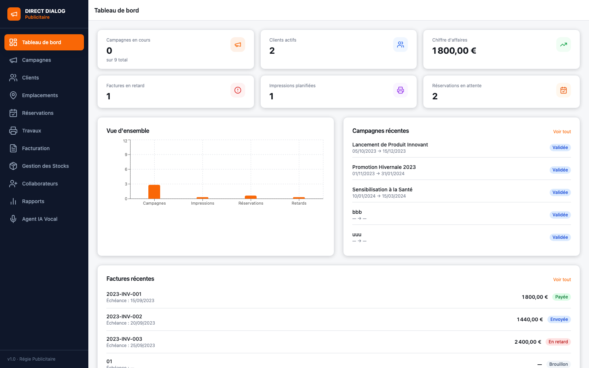
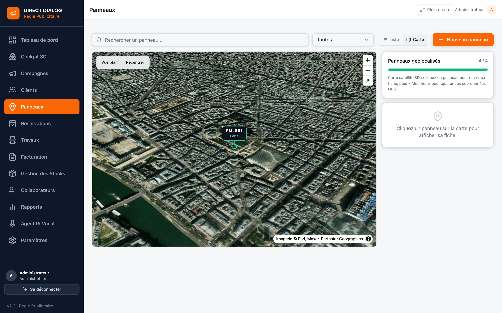
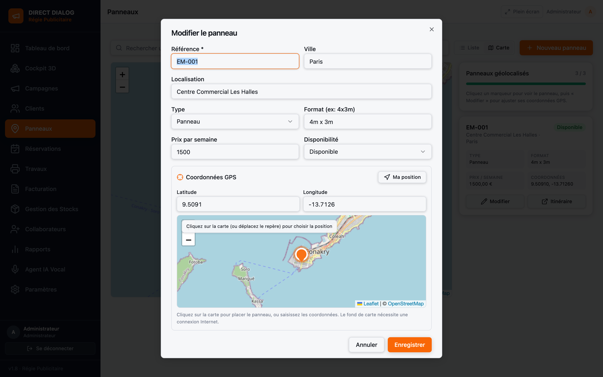
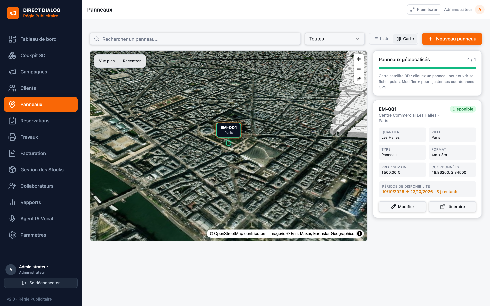
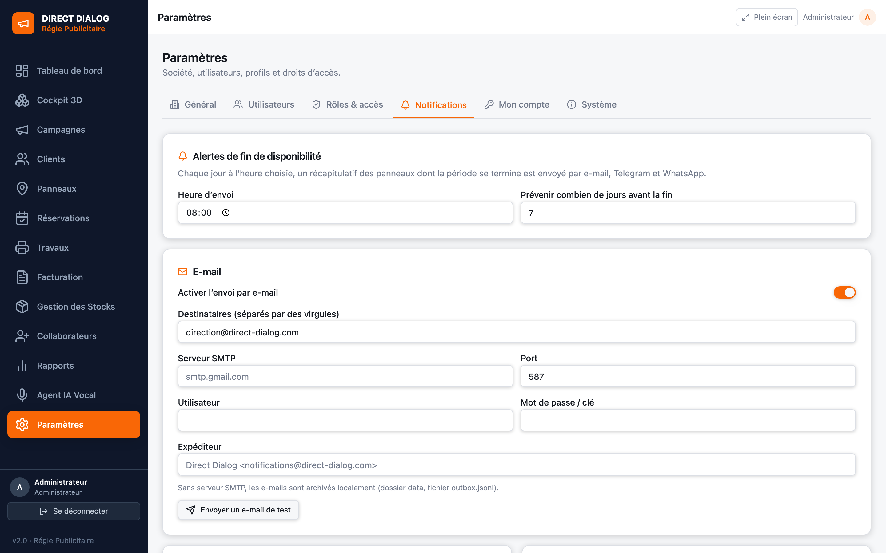
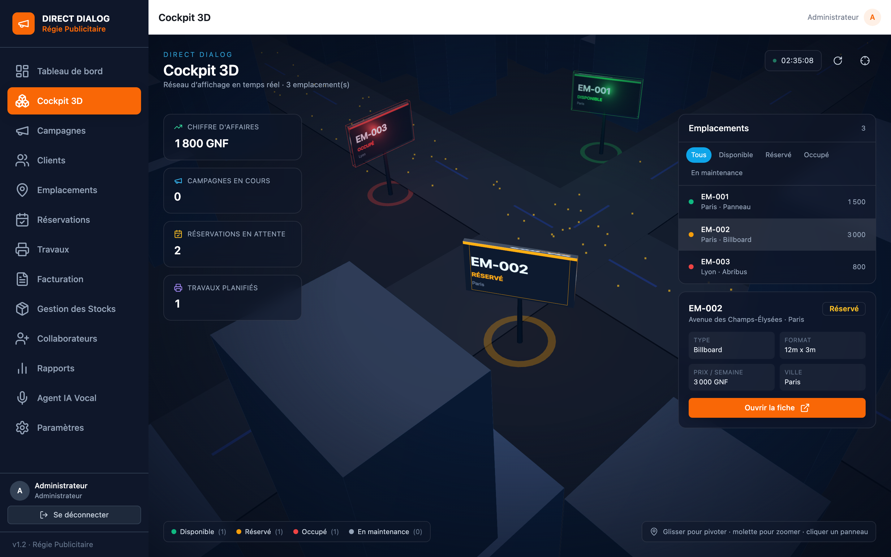
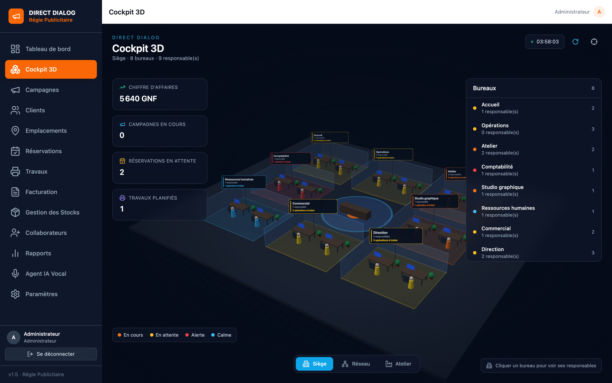
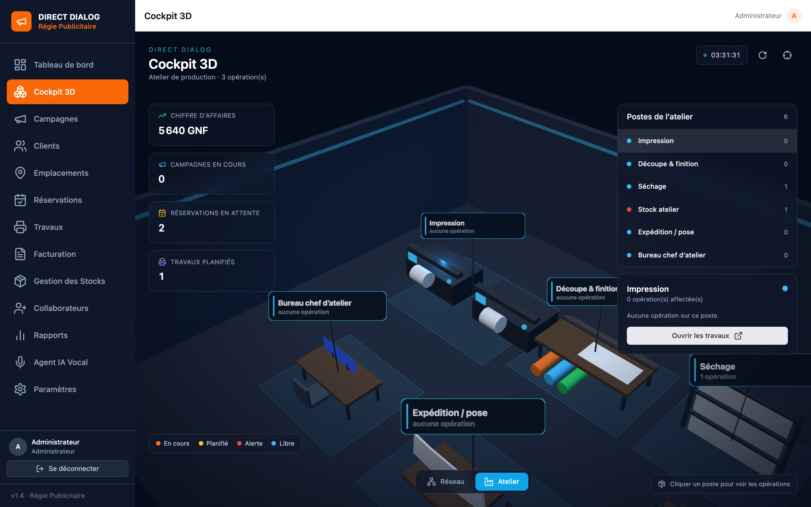

# DIRECT DIALOG

**Application de gestion pour régie publicitaire** : campagnes, clients, emplacements,
réservations, travaux & impressions, facturation, stock, collaborateurs, rapports et
assistant vocal — avec **gestion des utilisateurs par profil**, **droits d'accès par module**
un **tableau de bord de pilotage** dense et un **cockpit 3D** temps réel de votre réseau d'affichage.

[](https://github.com/Bah624/direct-dialog/actions/workflows/ci.yml)
[](https://github.com/Bah624/direct-dialog/actions/workflows/release.yml)
[](LICENSE)



---

## Installation chez un client

Une seule commande, sur une machine équipée de Docker :

```bash
curl -fsSL https://raw.githubusercontent.com/Bah624/direct-dialog/main/install.sh | sh
```

Le script télécharge la dernière version, construit l'image, démarre le service et vérifie
qu'il répond. À la fin : **[http://localhost:8080](http://localhost:8080)**.

Options utiles :

```bash
# Choisir le dossier, le port, ou une version précise
curl -fsSL .../install.sh | sh -s -- --dir /opt/direct-dialog --port 8090 --ref v1.0.0
```

**Mise à jour** : relancer exactement la même commande. Le code est remplacé, les données
sont conservées dans le volume Docker `direct-dialog-data`.

### Première connexion

Au premier démarrage, un compte administrateur est créé. Son mot de passe est soit celui
fourni dans `ADMIN_PASSWORD`, soit généré aléatoirement et affiché dans les journaux :

```bash
docker compose logs app | grep -A5 "Connexion administrateur"
```

Connectez-vous avec `admin@direct-dialog.local`, puis changez le mot de passe dans
**Paramètres → Mon compte**.

### Image publiée (installation instantanée)

Chaque version publiée produit une image sur GitHub Container Registry :

```bash
docker run -d --name direct-dialog -p 8080:8080 \
  -v direct-dialog-data:/app/data \
  ghcr.io/Bah624/direct-dialog:latest
```

> Le paquet `direct-dialog` est public : l'installation par image ne demande aucun
> identifiant. Vérifiable avec `docker pull ghcr.io/Bah624/direct-dialog:latest`.

---

## Démarrage depuis le dépôt

```bash
git clone https://github.com/Bah624/direct-dialog.git
cd direct-dialog
docker compose up -d --build
```

| Commande | Effet |
|---|---|
| `docker compose logs -f app` | journaux |
| `docker compose down` | arrêt (données conservées) |
| `docker compose down -v` | arrêt + remise à zéro des données |
| `curl http://localhost:8080/healthz` | état du service |

Le port est configurable sans éditer le fichier : `DIRECT_DIALOG_PORT=8090 docker compose up -d`.

---

## Développement

Prérequis : Node 22 et Yarn 1.

```bash
yarn install     # une seule fois
yarn dev         # interface sur :8080 (Vite), API sur :8787
```

Build de production local :

```bash
yarn build && yarn start     # http://localhost:8080
```

> Docker et l'instance locale utilisent le même port 8080 : arrêter l'un avant de lancer
> l'autre (`docker compose down` ou `pkill -f "server/dist/server.mjs"`).

---

## Tableau de bord de pilotage (v1.4)


La page d'accueil reprend les codes d'un CRM professionnel : l'essentiel en un écran.

| Bloc | Contenu |
|---|---|
| KPI | Encaissé, en attente de règlement, campagnes en cours, réservations à confirmer, panneaux disponibles |
| Évolution | Courbe des encaissements sur 6 mois d'activité (encaissé vs en attente), ancrée sur les derniers mois facturés |
| Relances & échéances | Factures en retard ou à échéance, réservations à confirmer, travaux planifiés, campagnes à valider — chaque ligne mène au module concerné |
| Campagnes récentes | Pipeline avec client, statut, période, budget et barre d'avancement |
| Meilleurs clients | Classement par montant facturé (repli automatique sur la répartition des campagnes quand aucune facture n'est rattachée) |
| Dernières factures | Statut de paiement et échéance |

Les montants s'adaptent à la devise configurée et les blocs financiers sont **masqués** pour
les profils qui n'ont pas accès à la facturation.

---

## Panneaux & carte GPS (v1.9)

Le module « Emplacements » devient **Panneaux**. Chaque panneau peut porter ses
**coordonnées GPS** et être localisé sur une carte.



- **Vue Liste / Vue Carte 3D** dans le module Panneaux.
- La carte 3D affiche le **satellite** et les **bâtiments en relief** (OpenStreetMap), avec un
  bouton **Vue plan / Vue 3D** et un recentrage automatique sur la ville des panneaux.
- Chaque panneau est un **bandeau plat et net** : bordure fine à la couleur de disponibilité,
  nom, ville, tige et repère au sol — sans dégradé ni effet de relief.
- Cliquer un marqueur ouvre la fiche du panneau (type, format, prix, coordonnées) avec un
  bouton **Itinéraire** vers Google Maps.
- Une colonne **Coordonnées GPS** apparaît dans la liste, et un bouton localise le panneau
  sur la carte.



**Saisir les coordonnées** : ouvrir la fiche d'un panneau, puis soit cliquer directement sur
la mini-carte (le repère se déplace), soit saisir latitude et longitude, soit utiliser
**Ma position** (géolocalisation du navigateur). Les coordonnées sont enregistrées avec le
panneau.

Le fond de carte est **OpenStreetMap** : il nécessite une connexion Internet. Sans réseau,
les marqueurs restent affichés sur un fond neutre.

## Fiche panneau et alertes de disponibilité (v2.1)



Cliquer un panneau **sur la carte 3D ou dans la liste** ouvre sa fiche complète :

- **quartier**, ville, localisation précise ;
- type, format, prix par semaine, coordonnées GPS ;
- **période de disponibilité** (du → au) avec le nombre de jours restants, en vert, ambre
  ou rouge selon l'échéance ;
- bouton **Itinéraire** (Google Maps).

Les dates se renseignent dans le formulaire du panneau (*Disponible du / Disponible au*),
avec le quartier.

### Notifications e-mail, Telegram et WhatsApp



*Paramètres → Notifications* permet de configurer :

| Canal | Réglages |
|---|---|
| **E-mail** | destinataires, serveur SMTP, port, utilisateur, mot de passe, expéditeur |
| **Telegram** | jeton du bot, chat ID |
| **WhatsApp** | jeton Meta Cloud API, identifiant du numéro, destinataire |

Chaque jour à **l'heure choisie**, le serveur envoie un récapitulatif des panneaux dont la
période se termine dans les **N jours** (seuil réglable) ou vient de se terminer. Le message
précise pour chaque panneau : référence, quartier, ville, localisation, **du → au**, et
l'échéance (« se termine dans 3 jours », « terminée depuis 2 jours »).

- Boutons **Tester** par canal et **Envoyer le récapitulatif maintenant**.
- **Historique** des 30 derniers envois et date du dernier envoi.
- Un seul envoi automatique par jour ; sans SMTP renseigné, l'e-mail est archivé localement
  dans `data/outbox.jsonl`.

## Paramètres, utilisateurs et rôles (v1.1)

Un module **Paramètres** est accessible depuis la barre latérale, avec quatre onglets :

| Onglet | Contenu |
|---|---|
| **Général** | Identité de la société (nom, slogan, adresse, téléphone, e-mail, logo), devise et taux de TVA par défaut |
| **Utilisateurs** | Création, modification et suppression des comptes : nom, e-mail, téléphone, profil, statut, notes |
| **Rôles & accès** | Matrice des droits par profil : pour chaque module, autoriser « Voir » et/ou « Gérer » |
| **Système** | Version, profil actif, volumes de données, sauvegarde JSON téléchargeable |

### Profils disponibles

Administrateur · Directeur général · Comptable · RH · Responsable des opérations ·
Responsable technique · Assistante de direction · Commercial · Graphiste · Machiniste ·
Chef d'atelier

Chaque profil reçoit par défaut un périmètre cohérent (le comptable gère la facturation, le
machiniste voit les travaux, le DG consulte tout et ne valide que les campagnes…). Tout est
modifiable dans **Rôles & accès**.

### Fonctionnement

- Le **profil actif** se choisit en bas de la barre latérale (sélecteur visible dès qu'il y a
  plusieurs comptes actifs). Il s'applique immédiatement à l'interface **et** aux appels API.
- Le menu latéral ne montre que les modules autorisés ; un accès direct par URL affiche
  « Accès non autorisé ».
- Les contrôles sont aussi appliqués **côté serveur** : un endpoint refusé renvoie `403`, y
  compris si l'on appelle l'API directement.
- Le profil **Administrateur** conserve toujours l'accès complet et ne peut pas être
  supprimé, rétrogradé ou désactivé s'il est le dernier.
- Au premier démarrage, un profil `Administrateur` est créé automatiquement
  (`admin@direct-dialog.local`) ; vous pouvez le renommer puis créer les comptes de votre
  équipe.

### Authentification

- Chaque utilisateur se connecte avec son **e-mail et son mot de passe**.
- Les mots de passe sont chiffrés en **scrypt** avec un sel aléatoire ; ils ne sont jamais
  stockés ni renvoyés en clair.
- La session repose sur un **cookie HttpOnly** signé (jeton aléatoire dont seule l'empreinte
  SHA-256 est stockée), valable 7 jours, avec expiration côté serveur.
- Après 8 tentatives échouées, la connexion est bloquée 5 minutes.
- Un administrateur peut **réinitialiser** un mot de passe depuis l'onglet Utilisateurs ; les
  sessions ouvertes de l'utilisateur sont alors coupées.
- Chacun change son mot de passe dans **Paramètres → Mon compte**.

---

## Cockpit 3D (v1.3)



Un écran d'accueil immersif : votre réseau d'affichage représenté en **ville isométrique 3D**,
chaque panneau publicitaire étant coloré selon sa disponibilité (Disponible, Réservé, Occupé,
En maintenance).

| Fonction | Détail |
|---|---|
| Scène | Ville procédurale, immeubles, avenues, circulation animée, éclairage nocturne |
| Panneaux | Un panneau 3D par emplacement, avec sa référence, sa ville et son statut dessinés sur l'écran |
| Caméra | Intro cinématique, rotation lente, orbite à la souris, zoom à la molette, recentrage |
| Interaction | Clic sur un panneau ou sur la liste → cadrage automatique + fiche détaillée |
| Filtres | Affichage par disponibilité (Tous / Disponible / Réservé / Occupé / En maintenance) |
| HUD | Chiffre d'affaires, campagnes en cours, réservations en attente, travaux planifiés, horloge |
| Robustesse | Three.js chargé à la demande ; repli sur un message clair si WebGL est indisponible |

### Siège 3D (v1.8)



Le cockpit s'ouvre sur le **siège** : quatre bureaux administratifs à gauche et un
**grand atelier** à droite.

| Espace | Responsables rattachés | Ce qui remonte |
|---|---|---|
| Direction générale | Directeur général, Administrateur | Validations et retards |
| Secrétariat | Secrétaire, Assistante de direction | Dossiers à suivre |
| Finances | Responsable des finances, Comptable | Factures en retard |
| Ressources humaines | RH | Effectif collaborateurs |
| **Atelier** | 7 responsables répartis sur 4 pôles | 5 opérations en cours |

L'**Atelier** est un seul espace cliquable qui contient les quatre pôles :

| Pôle | Responsables | Équipement modélisé |
|---|---|---|
| Opérations | Responsable des opérations, Assistante de gestion | Postes de travail |
| Imprimerie | Chef d'atelier, Machiniste, Responsable technique | **3 imprimantes, 1 table de découpe, 1 CNC** |
| Soudure | Soudeur | Établis, cadres métalliques, étincelles |
| Décoration | Décorateur, Graphiste | Tables de pose, rouleaux vinyle, panneaux |

Cliquer l'atelier ouvre sa fiche : les quatre pôles, leur nombre d'opérations et de
responsables, et l'accès direct au module. Cliquer un pôle (dans la scène ou dans la liste)
ouvre sa fiche détaillée.

### Vue Atelier (v1.8)



Le sélecteur **Atelier** (en bas) ouvre le même espace atelier, vu de plus près, avec ses
quatre pôles :

| Pôle | Contenu affiché |
|---|---|
| Opérations | Les postes du responsable des opérations et de l'assistante de gestion, les réservations à confirmer |
| Imprimerie | Les **trois imprimantes**, la **découpe** et la **CNC**, les travaux d'impression |
| Soudure | Les établis de soudure et les travaux de soudure / pose |
| Décoration | Les tables de pose et les travaux de décoration |

Le panneau de droite liste les pôles avec leur charge et ouvre le détail du pôle sélectionné.
Chaque pôle porte une **étiquette flottante** (nom + nombre d'opérations) et est **cliquable**.
Les couleurs indiquent l'état : en cours (orange), en attente (jaune), alerte (rouge), calme (bleu).

## Architecture

L'application vient d'un projet Zite : le navigateur appelait `POST /api/<endpoint>` et le
runtime Zite exécutait l'endpoint contre sa base. Cette chaîne est reproduite **sans Zite** :

```
Navigateur (React)
   │  POST /api/<endpoint>            ← zitejs/caller, inchangé
   ▼
server/dist/server.mjs (Express)
   │  exécute src/api/<endpoint>.ts   ← code métier d'origine, inchangé
   ▼
globalThis.__wrapSdkCall              ← pont local (server/src/sdk-bridge.ts)
   │
   ▼
server/src/store.ts  →  /app/data/db.json  (volume Docker)
```

Le code métier (29 endpoints, pages React, composants) n'a pas été réécrit : seul le runtime
a été remplacé. L'image Docker est autonome (bundle serveur + interface compilée, aucune
dépendance externe au démarrage).

### Contenu

```
apps/adcampaign-manager/     interface React (source Zite d'origine, 3 fichiers adaptés)
packages/components/         bibliothèque de composants shadcn/ui
server/
├── src/
│   ├── index.ts             serveur Express : API, envois de fichiers, statique
│   ├── bootstrap.ts         variables d'environnement + branchement du SDK
│   ├── sdk-bridge.ts        implémente zite.<table>.* en local
│   ├── store.ts             stockage (findAll/findOne/create/update/delete/bulkCreate)
│   ├── email.ts             e-mails archivés au lieu d'être envoyés
│   ├── schema.ts            schéma des 10 tables (généré)
│   └── endpoints.generated.ts (généré au build)
├── data/seed.json           données de départ
└── build.mjs                compilation du serveur en un fichier autonome
apps/adcampaign-manager/src/components/cockpit/  scènes 3D réseau + atelier (Three.js)
scripts/dev.sh               lancement sans Docker
install.sh                   installateur client
.github/workflows/           CI (build + tests de fumée) et release (image GHCR)
```

---

## Données

| Quoi | Où |
|---|---|
| Base | volume `direct-dialog-data` → `/app/data/db.json` |
| Pièces jointes, BAT | `/app/data/uploads/` |
| E-mails générés | `/app/data/outbox.jsonl` |

- Au premier démarrage, la base est créée à partir de `server/data/seed.json`.
- **Sauvegarde** :
  ```bash
  docker run --rm -v direct-dialog-data:/data -v "$PWD":/out alpine \
    tar czf /out/sauvegarde-direct-dialog.tgz -C /data .
  ```
- **Restauration** :
  ```bash
  docker run --rm -v direct-dialog-data:/data -v "$PWD":/out alpine \
    sh -c 'rm -rf /data/* && tar xzf /out/sauvegarde-direct-dialog.tgz -C /data'
  ```

### E-mails

L'application envoie un message aux collaborateurs (`notificationsActives = true`) quand une
campagne passe au statut **Validée**. Cette version n'expédie rien : le message est journalisé
et archivé dans `outbox.jsonl` (destinataire, objet, contenu).

### Agent IA vocal

La page « Agent IA Vocal » utilise OpenAI (Whisper + chat + synthèse vocale). Sans clé, elle
affiche une erreur ; le reste de l'application n'est pas affecté.

```bash
ZITE_OPENAI_ACCESS_TOKEN=sk-... docker compose up -d
```

---

## Vérifications effectuées

| Test | Résultat |
|---|---|
| `docker compose up -d` | conteneur `Up (healthy)` sur `0.0.0.0:8080->8080/tcp` |
| Interface (Chrome) | tableau de bord, campagnes, clients, rapports, accès direct aux URL |
| 11 endpoints de lecture | HTTP 200 |
| CRUD (`saveClient`, `saveCampagne`, `deleteClient`, `deleteCampagne`) | persisté |
| Envoi de pièce jointe | fichier stocké puis relu |
| E-mail de validation de campagne | `emailsSent: 1`, archivé dans `outbox.jsonl` |
| Redémarrage du conteneur | données et fichiers conservés |
| `curl /healthz` | `{"status":"ok", …}` |
| Création d'utilisateur + changement de profil | menu filtré (machiniste → Tableau de bord + Travaux) |
| Contrôle d'accès serveur | `getFactures` / `saveParametres` → `403` avec le profil Machiniste |
| Page Paramètres | 5 onglets, 13 modules × 11 profils de droits |
| API sans session | `401` (endpoints et export refusés) |
| Connexion (bon/mauvais mot de passe) | `200` / `401` |
| Changement de mot de passe | ancien refusé, nouveau accepté |
| Déconnexion | session invalidée (`401` ensuite) |
| Cockpit 3D | scène WebGL rendue, panneaux cliquables, cadrage + fiche détaillée |
| Vue Atelier | maquette 3D, 6 postes cliquables, opérations et alertes stock posées dessus |
| Siège 3D | 8 espaces, responsables rattachés par profil, navigation vers les modules |
| Panneaux & plein écran | panneaux masquables, mode immersif sans barre latérale |
| Tableau de bord | 5 KPI, courbe 6 mois avec données, relances cliquables, pipeline et répartition |

---

## Origine du code

| Élément | Détail |
|---|---|
| Source | projet Zite `8149a78247083f41` (application `ip2kuase4w`), 127 fichiers, `headSha 7c39eeae` |
| Frontend | React 18 + TypeScript + Vite + Tailwind + shadcn/ui |
| Métier | 29 endpoints d'origine + 6 ajoutés (`src/api/*.ts`) |
| Base | 10 tables d'origine (`zite.schema.json`) + 2 locales (`Utilisateurs`, `Parametres`) |
| Données | 38 enregistrements réels exportés (2 clients, 9 campagnes, 3 emplacements, 6 réservations, 3 impressions, 5 factures, 1 article, 5 sorties, 3 conversations, 1 collaborateur) |

Trois fichiers d'origine ont été adaptés (vérifiable par diff avec la source Zite) :

1. `apps/adcampaign-manager/vite.config.ts` — retrait du plugin `ziteId()` et du script
   `https://zite.com/app-runtime.js`, ajout du proxy de développement, correction de l'alias
   `zitejs/integrations`.
2. `apps/adcampaign-manager/index.html` — titre et favicon locaux.
3. `package.json` — scripts de build, de démarrage et Docker.

Plus l'ajout de `apps/adcampaign-manager/.env` (`VITE_ZITE_API_URL=/api`), requis par le SDK
d'envoi de fichiers.

---

## Limites connues (version de test)

- **HTTPS non fourni** : pour une mise en production, placer l'application derrière un
  reverse proxy TLS et activer `COOKIE_SECURE=1`.
- **Mono-utilisateur** : stockage JSON réécrit à chaque modification (à remplacer par
  PostgreSQL ou SQLite pour une exploitation multi-postes).
- **E-mails non expédiés**, intégrations tierces désactivées (Stripe, Google Maps…), non
  utilisées par le code métier récupéré.
- `zite.sql()` (SQL brut) n'est pas implémenté — aucun endpoint ne l'utilise.

---

## Dépannage

| Symptôme | Solution |
|---|---|
| `port is already allocated` | une instance locale occupe 8080 : `pkill -f "server/dist/server.mjs"` ou `DIRECT_DIALOG_PORT=8090 docker compose up -d` |
| Le démon Docker ne répond plus | disque plein : libérer de l'espace puis relancer Docker Desktop |
| Page blanche / 503 « Application non compilée » | `docker compose build --no-cache` |
| Données à remettre à zéro | `docker compose down -v` puis `docker compose up -d` |
| Voir les erreurs API | `docker compose logs -f app` |

---

## Licence

Logiciel propriétaire — © 2026 DIRECT DIALOG. Tous droits réservés.
Voir [LICENSE](LICENSE).
